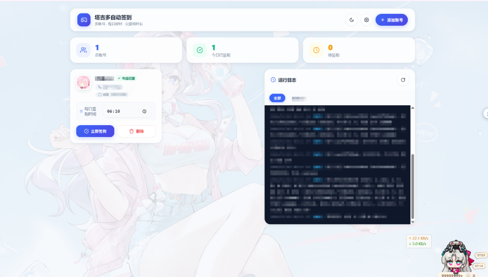
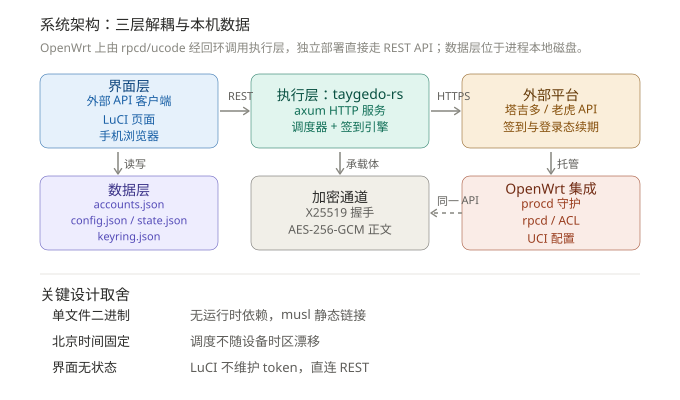
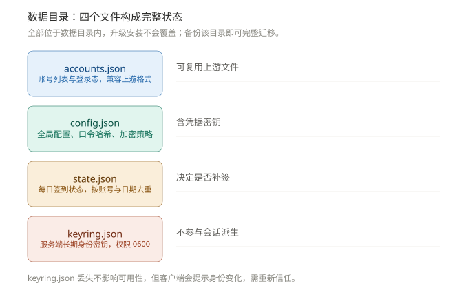
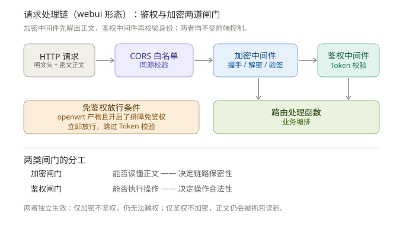
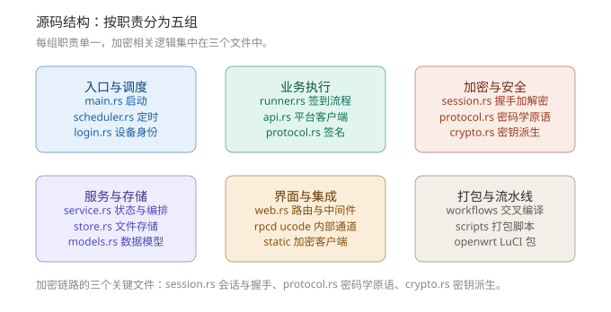

<div align="center">

# 🌸 塔吉多自动签到 (Rust 版)

基于 Rust 重写的塔吉多（幻塔 / 异环等）每日全自动签到工具，主打**简单易用、零门槛运行、极简纯白美学**。

[](https://www.rust-lang.org/)
[](./LICENSE)
[](#安装教程)
[](#界面展示)
[](#应用层加密与加密存储)
[](https://github.com/LianXia233/taygedo-CI/releases)

<p align="center">
  📦 <b>下载单文件、双击即启</b>，全部操作在<b>现代化白色 Material Design 3、自适应双端</b>的 WebUI 中完成。<br>
  ⚡ <b>深度适配 OpenWrt 主线与原生 LuCI 界面</b>，统一视觉体验，内置端到端应用层加密安全通道。
</p>

</div>

---

> [!TIP]
> **两层加密：链路上的，和磁盘上的**  
> 1. **传输层（应用层加密 v2）**：WebUI / LuCI 与后端之间的正文采用 **X25519 + HKDF-SHA256 + XChaCha20-Poly1305**，并由服务端 **Ed25519** 对完整握手 Transcript 与前端资源清单签名。公共网络、交换机镜像、共享 Wi-Fi 下被动抓包拿不到口令与 Token。详见 [docs/security-transport.md](docs/security-transport.md)。  
> 2. **存储层（加密存储）**：`accounts.json` / `config.json` / `state.json` / `keyring.json` 全部以 **XChaCha20-Poly1305** 密文落盘，主密钥按平台分别交给 systemd 凭据 / Windows DPAPI / root 0600 文件保护。磁盘、备份、镜像泄露都拿不到明文。详见 [docs/encrypted-storage.md](docs/encrypted-storage.md)。

> [!NOTE]
> **版本发布轨道**  
> - **正式版**（如 `v0.5.1`、`v0.5.2`）：稳定，推荐生产环境使用。访问 [Latest Release](https://github.com/LianXia233/taygedo-CI/releases/latest)。  
> - **`nightly` 版**：滚动预发布，每次手动触发构建后覆盖更新，供快速尝鲜。  
> 
> 📦 各平台安装包见 [Releases](https://github.com/LianXia233/taygedo-CI/releases)。上游逻辑参考 [zzstar101/taygedo-auto-attendance](https://github.com/zzstar101/taygedo-auto-attendance)（TypeScript 版，MIT 许可）。本项目自身代码以 **GPL-3.0** 发布，详见 [许可证](#许可证)。

---

## 🚀 三步上手（零门槛）

全程通过浏览器完成：添加账号、设置签到时间、查看审计日志与全局配置均在 Web 界面搞定。

<div align="center">
  
  <p><sub>图 1：按运行环境选择安装方式与包格式</sub></p>
</div>

| 步骤 | 🪟 Windows | 🐧 Debian / Ubuntu | 🌐 OpenWrt (软路由 / 硬件路由) |
| :---: | :--- | :--- | :--- |
| **① 下载** | 到 [Releases](https://github.com/LianXia233/taygedo-CI/releases) 下载 zip 并解压 | 下载对应架构的 `.deb` 包 | 下载对应架构的 `.ipk` 或 `.apk` |
| **② 运行** | **双击 `taygedo-rs.exe`**<br>*(自动唤起默认浏览器)* | `sudo dpkg -i taygedo-rs_*.deb`<br>`sudo systemctl enable --now taygedo-rs` | `opkg install` 或 `apk add`<br>*(安装完成后自动注册服务并启动)* |
| **③ 使用** | 浏览器打开 `http://127.0.0.1:8787`，用**首次启动生成的随机初始口令**登录 | 浏览器打开 `http://<服务器IP>:8787`，输入 `journalctl` 打印的口令登录 | 进入 LuCI 菜单：**服务 → 塔吉多签到**<br>*(默认开启内网免密直连)* |

> [!IMPORTANT]
> **关键安全须知**
> - **初始随机口令**：从 `0.5.0` 起彻底弃用固定 `admin/admin`。首次启动会自动生成高强度随机口令，**仅在启动横幅（控制台 / 系统日志）中打印一次**，登录后请立即在「设置」中修改。
> - **智能自适应加密**：加密默认开启（`crypto_policy=auto`）。局域网访问明文直通以节省嵌入式 CPU 算力，一旦请求来源脱离内网白名单便自动强制端到端加密，无需繁琐配置。

---

## 🎨 界面展示（White Material Design 3）

<div align="center">
  
  <p><sub>图 2：WebUI 主界面预览（白色 MD3 风格、看板统计、卡片管理与实时审计流）</sub></p>
</div>

访问 `http://<host>:8787`，使用启动日志输出的随机初始口令登录：

- **极简纯白 MD3 美学**：采用 Material Design 3 设计规范，精调纯白卡片面板与柔和阴影，辅以微透明毛玻璃效果（`backdrop-filter: blur(20px)`），视觉通透轻盈。
- **精美壁纸与新版角色头像**：保持经典精美背景壁纸（`uu4H/bg1.jpg`），叠加白昼毛玻璃遮罩；默认预置高清二次元粉发角色头像（Retina 级高清 Base64 直出，零外链零加载延迟）。
- **手机 & PC 双端完美响应式**：
  - **PC 桌面端**：双列网格自适应流式排版，大屏信息尽收眼底；
  - **手机移动端**：单列弹性折叠，支持 `viewport-fit=cover` 适配刘海屏与虚拟底条，针对触控热区深度优化，单手操作体验极佳。
- **看板与账号卡片**：
  - 顶部 MD3 彩标晶片卡片直观呈现账号数、今日已签与排队待签；
  - 账号卡片采用 20px 圆角立体设计、状态胶囊徽章（Chip）与一键式便捷操作（「立即签到」、「修改计划」、「删除」）。
- **前端热加载机制**：后端支持优先加载 `/etc/taygedo/ui.html` 或 `/www/taygedo/ui.html`，无需重编二进制即可无感热替换自定义前端样式。

---

## 🌟 功能特性

<div align="center">
  
  <p><sub>图 3：系统架构（界面层与执行层通过 REST API 交互，本地状态独占落盘）</sub></p>
</div>

### 易用与交互
- **开箱即用，零门槛**：单文件绿色分发，双击解压即用；所有操作集成于 Web 界面，无需配置复杂命令行参数。
- **白色 MD3 响应式 UI**：统一 WebUI 与 LuCI 视觉体验，支持手机/PC 双端响应式流动排版与微动效。
- **实时日志看板**：WebUI 实时输出带毫秒级时间戳的详细流水审计日志。

### 账号与多模式登录
- **多账号管理**：支持录入任意数量的游戏账号，独立调度、互相隔离。
- **双模态认证**：
  - **密码登录**：密码在本地经由 `scrypt + AES-256-GCM` 加密落盘，向下兼容上游数据格式。
  - **短信验证码登录**：WebUI 支持一键下发短信验证码，快速免密授权。

### 自动化调度与执行
- **精确时区调度**：独立调度器严格锁死**北京时间（UTC+8）**运行，消除宿主机时区影响；跨平台（Windows / Linux / OpenWrt）触发时刻完全一致。
- **开机与断网自动补签**：若设定时刻机器处于关机或离线状态，进程启动后自动完成当天**补签**；单账号单日严格触发一次，已签到自动跳过。
- **全任务签到链路**：APP 每日签到、逐游戏打卡（幻塔 1256、异环 1289 等，呈现中文游戏名）、金币任务（打卡/浏览/点赞/分享）、云异环时长托管。
- **幽灵角色阻断机制**：优先以 `getGameRecordCards` 战绩卡构建角色与游戏映射，避免 `getGameRoles` 偶发返回幽灵角色触发整账号 `code=5050` 报错。
- **高可用会话自动续期**：`accessToken` 失效 $\rightarrow$ 自动调用 `refreshToken` $\rightarrow$ 失败再经由 `laohuToken` 重建会话 $\rightarrow$ 仍失败则通过加密凭据静默重登。

### 安全防护与加固
- **双重认证鉴权**：API 访问受 Token 鉴权保护（7 天有效期）。口令哈希使用 **scrypt（N=16384, r=8, p=1）+ 恒定时间比对**（旧 `sha256` 单轮哈希首次登录自动原地升级）。修改密码后已签发 Token 瞬间全部吊销，登录接口内置失败速率限制（HTTP 429）。
- **内网免鉴权模式（可选）**：通过环境变量 `TAYGEDO_NO_AUTH=1` 或 OpenWrt UCI `option no_auth '1'`（默认已开）启用，内网环境直接免密控制。非内网来源严格阻断放行。
- **应用层端到端加密**：全链路采用 **X25519 临时密钥交换 + HKDF-SHA256 + AES-256-GCM**，提供前向保密、单调递增 Nonce 防重放与 AAD 上下文绑定。实测嗅探环境下账号密码与 Token 暴露频次为 **0 次**。
- **全局控制面板**：配置默认执行时间、金币打卡任务、云游戏时长、分享平台、管理密码变更及安全退出。
- **日志审计流**：右侧内置高刷新率实时运行终端。

---

## 安装教程

### 平台包格式速查

| 平台环境 | 文件名格式 | 架构 / 说明 |
| :--- | :--- | :--- |
| **Windows (64 位)** | `taygedo-rs-windows-x86_64.zip` | 绿色解压即用单文件程序 |
| **Debian / Ubuntu (amd64)** | `taygedo-rs_<版本>_amd64.deb` | 集成 systemd 服务与开机自启 |
| **OpenWrt (x86_64 软路由)** | `luci-app-taygedo_<版本>-1_x86_64.[ipk/apk]` | 包含完整 LuCI 前端与后端守护 |
| **OpenWrt (ARM64 路由)** | `luci-app-taygedo_<版本>-1_aarch64_cortex-a53.[ipk/apk]` | 适配 MT7986、Rockchip 等嵌入式平台 |
| **Linux 通用 (musl)** | `taygedo-rs-<arch>-unknown-linux-musl.tar.gz` | 静态编译，适合容器及轻量发行版 |

> [!NOTE]
> OpenWrt **24.10 及以上**版本采用 `apk` 包管理器；OpenWrt **23.05 及以下**版本使用 `opkg` (`ipk`)。

---

### Windows 安装

1. **下载解压**  
   在 [Releases](https://github.com/LianXia233/taygedo-CI/releases) 下载 `taygedo-rs-windows-x86_64.zip` 并解压得到 `taygedo-rs.exe`。

2. **启动运行**  
   - **方式一（快捷）**：直接双击 `taygedo-rs.exe`，启动后台服务并自动弹出浏览器。  
   - **方式二（命令行推荐）**：打开 PowerShell 便于传参或观察启动输出：
     ```powershell
     # 启动服务
     .\taygedo-rs.exe

     # 可选：自定义环境变量
     $env:TAYGEDO_LISTEN = "0.0.0.0:8787"        # 自定义监听端口（默认 8787）
     $env:TAYGEDO_DATA_DIR = "D:\taygedo-data"   # 自定义数据存储目录（默认 .\data）
     $env:TAYGEDO_WEB_PASSWORD = "YourPassword"  # 可选：显式指定初始管理密码
     .\taygedo-rs.exe
     ```

3. **进入管理页面**  
   浏览器访问 `http://127.0.0.1:8787`，输入控制台打印的初始口令登录。

4. **开机自启（可选）**  
   - 快捷方式放入自启目录：按 `Win + R` 输入 `shell:startup`，将 `taygedo-rs.exe` 的快捷方式粘贴进去。  
   - 或使用「任务计划程序」创建登录触发的高权限任务。

5. **局域网访问放行（可选）**  
   ```powershell
   netsh advfirewall firewall add rule name="taygedo" dir=in action=allow protocol=TCP localport=8787
   ```

---

### Debian / Ubuntu 安装

1. **安装软件包**  
   ```bash
   sudo dpkg -i taygedo-rs_<版本>_amd64.deb
   sudo apt-get install -f    # 补全依赖（通常为零依赖）
   ```

2. **启动并激活开机自启**  
   ```bash
   sudo systemctl enable --now taygedo-rs
   sudo systemctl status taygedo-rs
   ```

3. **自定义环境变量（可选）**  
   ```bash
   sudo systemctl edit taygedo-rs
   ```
   在编辑界面中填入以下内容并保存退出：
   ```ini
   [Service]
   Environment=TAYGEDO_LISTEN=0.0.0.0:8787
   Environment=TAYGEDO_DATA_DIR=/var/lib/taygedo
   Environment=TAYGEDO_WEB_PASSWORD=YourPassword
   ```
   应用生效：
   ```bash
   sudo systemctl daemon-reload
   sudo systemctl restart taygedo-rs
   ```

4. **获取口令与审计日志**  
   从 systemd 日志中提取首次启动生成的随机口令：
   ```bash
   sudo journalctl -u taygedo-rs -f
   ```
   数据默认持久化至 `/var/lib/taygedo`。

---

### OpenWrt 安装与 LuCI 配置

1. **安装对应的架构包**  
   ```sh
   # opkg 安装（OpenWrt 23.05 及更早版本）
   opkg install /tmp/luci-app-taygedo_<版本>-1_x86_64.ipk

   # apk 安装（OpenWrt 24.10 及更新版本）
   apk add /tmp/luci-app-taygedo_<版本>-r1_x86_64.apk
   ```

2. **开箱即用状态**  
   安装脚本自动完成注册并拉起服务，`/etc/config/taygedo` 默认注入 `enabled '1'` 与 `no_auth '1'`。直接打开路由器管理界面：**服务 → 塔吉多签到** 即可直连控制面板。

3. **免鉴权模式特性**  
   - **已开启免鉴权（默认）**：局域网访问 LuCI 直接免密联动后端 API。
   - **未开免鉴权**：LuCI 提示认证引导卡片，点击右上角「外部 WebUI」跳转至 `:8787` 输入随机口令登录。
   - **解耦机制**：UCI（`/etc/config/taygedo`）专注服务级控制（启停/端口/网段）；业务配置（签到时刻/任务开关）由 `config.json` 托管，重启服务互不覆盖。

   | 维度 | 说明 |
   | :--- | :--- |
   | **生效边界** | 仅作用于 `/api/*` REST 接口，**不改变 LuCI 原生系统的认证机制与 ACL** |
   | **放行约束** | 需同时满足 `no_auth=1` 且请求 IP 命中 `lan_cidrs` 白名单；公网流量严格拒绝 |
   | **网络安全** | 仅建议在受信任局域网启用；若直接暴露公网映射，请置为 `no_auth=0` |
   | **加密隔离** | 与 `crypto_policy` 独立互不干扰，非受信任网段自动强制密文传输 |

4. **UCI 控制命令参考**  
   ```sh
   # 切换免鉴权模式
   uci set taygedo.main.no_auth=1 && uci commit taygedo && /etc/init.d/taygedo restart

   # 修改监听端口
   uci set taygedo.main.port=8787 && uci commit taygedo && /etc/init.d/taygedo restart

   # 查看运行日志与提取初始随机口令
   /etc/init.d/taygedo status
   logread | grep taygedo
   ```

---

## 通用使用指南

<div align="center">
  
  <p><sub>图 4：每日定时签到执行流程时序</sub></p>
</div>

- **控制台登录**：0.5.0 起首次生成随机口令（控制台仅输出一次），登录后务必在「设置」中修改口令（长度 $\ge$ 8），成功后原所有 Token 立即作废。
- **绑定账号**：在「添加账号」弹窗中，根据需求选择账号密码认证或短信验证码直登。
- **设置时刻**：可在「全局设置」指定统一打卡时刻，亦可在各账号卡片上单独定制差异化执行时间。
- **手动触发**：点击卡片上的「立即签到」可随时手动拉起全流程任务。
- **多账号轮询**：重复添加流程即可，多账号互不干扰、独立保存登录凭据与执行状态。

---

## 从源码构建

### Docker 容器化构建（推荐）

```bash
docker compose up -d --build
```
启动后访问 `http://localhost:8787`，所有数据自动持久化于 `./data`。

### Cargo 本机编译

需要已安装稳定版 Rust 工具链（Stable）：

```bash
cargo run --release
```

**支持的环境变量配置**：

| 环境变量 | 默认值 | 功能说明 |
| :--- | :--- | :--- |
| `TAYGEDO_LISTEN` | `0.0.0.0:8787` | HTTP 监听地址与绑定端口 |
| `TAYGEDO_DATA_DIR` | `data` | 数据持久化存放目录 |
| `TAYGEDO_WEB_PASSWORD` | 无 | 显式指定初始管理密码（未配置则使用 CSPRNG 动态生成，仅首次初始化有效） |
| `TAYGEDO_DEFAULT_SCHEDULE` | 无 | 覆盖全局默认签到时刻（格式：`HH:MM`） |
| `TAYGEDO_COIN_TASKS` | 无 | 覆盖金币打卡任务开关（`true` / `false`） |
| `TAYGEDO_CLOUD_DURATION` | 无 | 覆盖云异环时长开关（`true` / `false`） |
| `TAYGEDO_SHARE_PLATFORM` | 无 | 覆盖分享渠道标记 |
| `TAYGEDO_NO_AUTH` | `false` | 免登录模式开关（`1/true/yes/on` 启用） |

### Windows 交叉编译

```bash
rustup toolchain install stable-x86_64-pc-windows-gnu
cargo +stable-x86_64-pc-windows-gnu build --release
```

---

## 多平台 / 多架构支持

底层采用 musl 全静态链接构建，由 GitHub Actions 交叉编译自动化发布：

| OpenWrt 架构目标 | Rust Target Triple | 典型适用设备 |
| :--- | :--- | :--- |
| **x86_64** | `x86_64-unknown-linux-musl` | 常见 PC 软路由、工控机、PVE/ESXi 虚拟机 |
| **aarch64 (cortex-a53)** | `aarch64-unknown-linux-musl` | MediaTek MT7986、Rockchip RK3568/RK3588 等现代路由器 |

---

## OpenWrt / LuCI 集成（开发者）

`openwrt/luci-app-taygedo/` 提供了规范的 LuCI 扩展工程：

- **体验完全对齐**：原生 JavaScript 视图层与独立 WebUI 功能高度一致。
- **服务分层解耦**：LuCI 页面基于 RESTful API 直连交互；UCI 仅维护进程级状态。
- **进程生命周期管理**：结合 `procd` 体系实现崩溃拉起、热加载与守护。

```
openwrt/luci-app-taygedo/
├── Makefile                        # 编译与打包控制定义
├── htdocs/
│   └── luci-static/resources/view/taygedo/
│       └── status.js               # 现代化 LuCI JS 前端
└── root/
    ├── etc/config/taygedo          # UCI 默认配置文件
    ├── etc/init.d/taygedo          # procd 守护脚本
    └── usr/share/
        ├── luci/menu.d/taygedo.json
        └── rpcd/acl.d/luci-app-taygedo.json
```

编译方法：将该目录置于 OpenWrt 源码树的 `package/` 或 自定义 feeds 中，执行 `make menuconfig` 勾选 `LuCI → Applications → luci-app-taygedo` 后编译。

---

## 应用层加密与加密存储

**两条独立的安全边界：浏览器 ↔ 后端（传输），后端 ↔ 磁盘（存储）。**
完整规格见 [docs/security-transport.md](docs/security-transport.md) 与
[docs/encrypted-storage.md](docs/encrypted-storage.md)，本节只讲"是什么、怎么开、边界在哪"。

<div align="center">
  
  <p><sub>图 5：应用层加密原理图（加密边界与会话派生链路）</sub></p>
</div>

> [!IMPORTANT]
> 本机制**不是 TLS 的替代品**。它解决的是"没有可信证书、只能用普通 HTTP"的场景下
> "正文在链路上是明文"这个问题。能上 TLS 就应该上 TLS，两者叠加是最佳实践。

### 一、传输加密（协议 `taygedo/v2`）

| 环节 | 算法 | 关键点 |
| :--- | :--- | :--- |
| 服务端身份 | **Ed25519** | 长期身份密钥在 `keyring.json`（本身也是密文），`kid` = 16 hex |
| 密钥交换 | **X25519** | 每次握手生成**临时**密钥对 → 前向保密 |
| 密钥派生 | **HKDF-SHA256** | `salt = SHA-256(transcript)`，`info` 分 `c2s` / `s2c` / `bind` |
| 正文加密 | **XChaCha20-Poly1305** | 24 字节随机 nonce；双向密钥分离，杜绝反射攻击 |
| 握手认证 | **Ed25519 签完整 Transcript** | 版本 + 双方临时公钥 + 双方 nonce + 身份公钥 + sid + ts，逐字段改都会验签失败 |
| 请求绑定 | AAD | `kid ‖ sid ‖ seq ‖ method ‖ path?query ‖ nonce` |
| 响应绑定 | AAD | 追加 `req_seq`；客户端校验 `rseq == 请求 seq` |
| 防重放 | 滑动窗口（4096） | 仅在 AEAD 成功**之后**消费序号，伪造报文不能挤掉合法序号 |
| 前端资源完整性 | **Ed25519 签名清单** + 逐文件 SHA-256 | 11 个资源；校验不通过则业务 JS 不执行、登录按钮禁用 |

**握手流程（浏览器视角）**

```
1. POST /api/crypto/handshake {proto, client_pub, client_nonce}
2. 收到 {sid, server_pub, identity_pub, ts, sig, ...}
3. 重建 transcript → 用 identity_pub 验签（失败即中止）
4. 指纹比对：SHA-256(identity_pub)[0..16] 与本地固定值一致？（不一致即拒绝）
5. salt = SHA-256(transcript) → 派生 c2s / s2c
6. 之后每个业务请求都带密文信封，响应也是密文信封
```

**为什么浏览器不用 `crypto.subtle`**：`subtle` 只在安全上下文（HTTPS / localhost）
可用，而本项目典型部署是 `http://192.168.x.x:8787`，`subtle` 直接是 `undefined`。
因此前端内置纯 JS 实现（`@noble/*`，MIT，经 Cure53 审计），只依赖
`crypto.getRandomValues`。

**GET 请求的特殊处理**：HTTP 语义不允许 GET 带 body，浏览器与 Node `undici` 会
直接抛错，所以 GET/HEAD 的信封放在请求头 `X-TGD-Envelope`（base64url 的 JSON）。
它与 body 里的信封走完全相同的解析与 AAD 校验路径；同一请求两者并存会被
`400 malformed` 拒绝，不留歧义。

### 二、`crypto_policy` 准入策略

| 策略值 | 行为 | 适用场景 |
| :---: | :--- | :--- |
| **`auto`** *(默认)* | 内网白名单明文直通，非内网来源强制加密 | 家用局域网直连，公网映射时自动受保护 |
| **`always`** | 所有来源强制加密，明文请求返回 `428 Precondition Required` | 合规要求高、链路不可信 |
| **`never`** | 不强制加密（**显式**运维关闭项，启动横幅会告警） | 排障、前置 TLS 反代 |

默认内网网段：`10/8, 172.16/12, 192.168/16, 127/8, 169.254/16, ::1/128, fc00::/7, fe80::/10`
（基于真实连接 IP 判定，忽略 `X-Forwarded-For`，防伪造）。

> [!NOTE]
> `never` 与"auto + 内网"两条明文路径都是**显式策略分支**，由配置决定，
> 不是"解密失败后自动回退"。任何解密/认证失败都只会返回加密层错误。
> 当前策略在 `/api/meta`（`crypto_policy` / `crypto_required`）里公开可查。

### 三、前端资源完整性（纯 HTTP 下必须正视的问题）

普通 HTTP 下攻击者可以替换 JS。因此启动链是：

```
web_guard.js → 拉 /static/manifest.json → 用 identity_pub 验签
             → 与 localStorage 里固定的指纹比对
             → 逐文件 SHA-256 比对（共 11 个资源，含 / 首页 HTML）
             → 全部通过才置 window.TgdIntegrity.ok = true
```

`taygedo-crypto.js` 每次握手前强制检查该标志；`ui.html` 在失败时**禁用登录**并
显示原因。即"校验不过就用不了"，不是"警告一下继续用"。

**必须知情的限制**：首次访问时的 TOFU 窗口无法消除——那一刻客户端还没有任何
可信锚点。缓解办法是部署后立即核对一次指纹并记录下来，后续任何变更都会被拒绝。
详见 [docs/security-transport.md §7.3](docs/security-transport.md)。

### 四、加密存储（静态加密）

<div align="center">
  
  <p><sub>图 6：多域隔离密钥派生链结构</sub></p>
</div>

| 项 | 值 |
| :--- | :--- |
| 算法 | XChaCha20-Poly1305 + HKDF-SHA256，OS CSPRNG 生成 salt/nonce |
| 格式 | 86 字节头部（Magic `TGDENV01` / 版本 / 算法 / KeyID / Salt32 / Nonce24 / ct_len）+ 密文 + 16B tag |
| 绑定 | AAD 绑定**文件逻辑身份** + 格式版本 + 主密钥 KeyID，跨文件搬移必失败 |
| 主密钥 | 32B，`keys/master.key`（0600）或 systemd 凭据或 DPAPI |
| Key ID | `hex(SHA-256("…key-id/v1" ‖ master)[0..8])`，日志只出现它，不出现密钥 |

三平台主密钥保护：

| 平台 | 方式 | 强度边界 |
| :--- | :--- | :--- |
| Debian 13 / Linux | `LoadCredentialEncrypted`（TPM2 优先）→ 回落 root 0600 文件 | 凭据路径下密钥不以可读文件存在 |
| Windows | DPAPI（默认用户作用域，`TAYGEDO_DPAPI_MACHINE=1` 切机器作用域） | 别的用户/别的机器解不开 |
| OpenWrt | root:root 0600 文件（不依赖 systemd/TPM，不影响 procd 与 LuCI） | **等于文件权限强度**，root 即可读 |

旧版明文**自动迁移**：识别 Magic → 校验 JSON 结构 → 加密 → 临时文件 → 回读校验
→ 原子替换 → 保留**加密**备份（`.enc-bak-<ts>`）→ 记录 journal。中断可续、幂等、
失败不动原文件。详见 [docs/encrypted-storage.md](docs/encrypted-storage.md)。

```bash
# 轮换主密钥（新密钥先落 pending，逐文件重加密，全部成功后提升）
taygedo-rs --rotate-storage-key
# 输出：主密钥已轮换：<旧 KeyID> -> <新 KeyID>
```

> [!CAUTION]
> **主密钥丢失 = 数据永久不可解**。没有恢复码、没有后门、不会"自动重建密钥"
> （那只会让你以为数据还在）。请把 `keys/master.key` 与密文**分开**离线备份。
> 迁移备份同样是密文，所以它也依赖同一把密钥。

### 五、密钥存储与生命周期

- **身份密钥**（传输层）：`keyring.json` 内 32 字节 CSPRNG 种子，文件本身也是密文；
  删除后重启会生成新身份，所有已 pin 指纹的客户端会告警"服务端身份已变更"。
- **主密钥**（存储层）：见上表；`--rotate-storage-key` 可轮换，轮换后 Key ID 变化。
- **会话**：TTL 30 分钟 / 单会话 20 万请求 / 最多 256 个并发会话 / 握手限流
  60 秒 60 次；会话结束即 `zeroize` 清零密钥，**服务重启后旧会话全部失效**。
- **Token**：只放在 `Authorization: Bearer`，位于信封内部（被加密），不写 Cookie、
  不进 URL、不进日志。

### 六、验证状态（诚实版）

**本次改造实际执行过的验证**（命令与结果见 CHANGELOG 与提交说明）：

| 校验项 | 手法 | 结果 |
| :--- | :--- | :---: |
| 单元/集成测试 | `cargo test` | **96 passed / 0 failed** |
| 端到端协议 | `node scripts/e2e_web.mjs`（真实二进制 + 真实前端文件） | **21/21 通过** |
| 资源完整性 | 同上，加载**仓库里真实的 `web_guard.js`** 对真实清单执行：验签、11 资源哈希、TOFU、指纹已固定、指纹变更拒绝、资源被替换拒绝、恢复后自愈 | **7/7 通过** |
| 落盘密态 | `store::tests`：断言文件以 `TGDENV01` 开头且不含明文手机号/密码/`credential_key` | **通过** |
| 密钥缺失 | 删 `keys/master.key` 后启动 | `[fatal]` 退出、不改文件 |
| 密文篡改 | 改密文一位后启动 | `[fatal]` 退出、原文件不变 |
| 权限过宽 | `chmod 644 keys/master.key` | 拒绝启动并报权限错误 |
| 并发写 | 两个进程同时打开同一数据目录 | 第二个 `Locked` 退出 |
| 轮换 | `--rotate-storage-key` | 数据可读、Key ID 变化、断电续做 |
| 格式检查 | `cargo fmt --all -- --check` / `cargo clippy --all-targets -- -D warnings` | **均无输出** |

**尚未在本环境执行的验证**（下面这些需要真机/真浏览器，不能替它们盖章）：

| 待验证项 | 需要什么 |
| :--- | :--- |
| `tcpdump` 抓包对照（密文 vs `never` 明文） | 一台可抓包的主机 |
| ImmortalWrt / Filogic / aarch64 真机运行 | 软路由设备 |
| 浏览器内替换 JS 触发完整性拦截 | 真实浏览器 + 手工改服务端文件 |
| Windows DPAPI 用户/机器作用域切换 | Windows 主机 |
| systemd `LoadCredentialEncrypted` + TPM2 | 带 TPM 的 Debian 13 |

---

## 数据与兼容性

<div align="center">
  
  <p><sub>图 8：数据存储体系及落盘映射</sub></p>
</div>

数据目录（默认 `./data` 或 `/var/lib/taygedo`、`/etc/taygedo`）：

| 路径 | 内容 | 落盘形态 |
| :--- | :--- | :--- |
| `accounts.json` | 账号列表（手机号、密码、token、设备指纹） | **密文**（`TGDENV01`） |
| `config.json` | 口令哈希、`credential_key`、调度、开关 | **密文** |
| `state.json` | 签到幂等缓存（账号 + 日期） | **密文** |
| `keyring.json` | 传输层 Ed25519 身份私钥种子 | **密文** |
| `keys/master.key` | 存储层主密钥（32B） | 受 OS 保护（见下） |
| `*.enc-bak-<ts>` | 迁移时的加密备份（最多 3 份） | **密文** |
| `.storage-migration.json` | 迁移 journal（不含敏感值） | 明文（无敏感信息） |
| `.storage.lock` | 排他锁（防并发实例同时迁移/写） | 空文件 |

主密钥位置随平台不同：Linux 优先 systemd 凭据（`$CREDENTIALS_DIRECTORY/taygedo_storage_key`），
否则 `keys/master.key`（root `0600`）；Windows 为 `keys/master.key.dpapi`（DPAPI）；
OpenWrt 为 `keys/master.key`（root `0600`，目录 `0700`）。

> [!IMPORTANT]
> **升级兼容**：0.4.x / 0.5.x 的明文数据目录可以直接用。首次启动会自动迁移成密文，
> 并留下加密备份；迁移**幂等**，中途失败重启会续做，且**绝不覆盖**无法解密的文件。
> 但请注意：迁移完成后若丢失 `master.key`，密文与备份**都无法恢复**。

> [!NOTE]
> **口令散列兼容**：0.4.x 的历史单一 `sha256` 口令散列仍会在首次验证成功后自动升级为
> `scrypt v2`，无需重置数据。注意此时 `config.json` 已是密文，**不能**再用文本编辑器
> 直接改（改了会导致认证失败）。忘记口令请按 FAQ Q2 的流程处理。

---

## API 规范一览

<div align="center">
  
  <p><sub>图 9：网关拦截与分层认证过滤体系</sub></p>
</div>

所有受保护接口的请求体都是**加密信封**（`POST` 放 body，`GET`/`HEAD` 放 `X-TGD-Envelope` 头），
Token 放在 `Authorization: Bearer <token>`（位于信封内部，随正文一起加密；0.5.0 起已废弃 Cookie
凭据传递以阻断 CSRF）。未建立加密会话时业务接口返回 `428`。

| 方法 | API 路径 | 认证要求 | 作用说明 |
| :---: | :--- | :---: | :--- |
| `POST` | `/api/crypto/handshake` | 公开 | 加密通道握手：换临时密钥 + 服务端 Ed25519 签完整 Transcript |
| `GET` | `/api/secure/identity` | 公开 | 服务端身份公钥 / `kid` / 指纹（供客户端固定与核对） |
| `GET` | `/static/manifest.json` | 公开 | 前端资源签名清单（Ed25519 签名 + 逐文件 SHA-256） |
| `POST` | `/api/login` | 公开 | 凭据登录认证（触发限速：60 秒内失败 5 次返回 HTTP 429） |
| `GET` | `/api/meta` | 公开 | 读取服务端环境参数、加密约束策略与改密要求 |
| `POST` | `/api/password` | 鉴权 | 修改管理员登录账号及口令（成功后既有 Token 瞬间吊销） |
| `POST` | `/api/logout` | 鉴权 | 注销 Token 并立即销毁关联的加密上下文 |
| `GET` | `/api/accounts` | 鉴权 | 拉取账号摘要列表（敏感字段脱敏输出） |
| `POST` | `/api/accounts` | 鉴权 | 录入并登录新游戏账号（支持密码或验证码） |
| `DELETE`| `/api/accounts/{id}` | 鉴权 | 删除指定账号配置与关联数据 |
| `POST` | `/api/accounts/{id}/signin` | 鉴权 | 手动触发指定账号打卡任务（可选 `force` 参数） |
| `POST` | `/api/accounts/{id}/schedule`| 鉴权 | 定制单账号独立签到计划时刻（`{ "time": "HH:MM" }`） |
| `POST` | `/api/send-code` | 鉴权 | 向目标手机号请求下发登录验证码 |
| `GET` | `/api/config` | 鉴权 | 读取全局配置字典 |
| `POST` | `/api/config` | 鉴权 | 更新全局系统配置 |
| `GET` | `/api/logs` | 鉴权 | 拉取实时审计日志（支持 `limit` 参数控制条数） |

---

## 目录结构

<div align="center">
  
  <p><sub>图 10：源码模块组织架构与职能划分</sub></p>
</div>

```
src/
├── main.rs              # 启动装配、CLI（--rotate-storage-key）、定时任务
├── api.rs               # 游戏平台与老虎 API 客户端（签名计算、加密解密）
├── protocol.rs          # 上游协议原语：AES-128 签名、X25519/HKDF 复用件
├── runner.rs            # 自动签到核心流水线
├── crypto.rs            # 账号凭据二次加密（scrypt + AES-256-GCM）与口令散列
├── service.rs           # 业务编排、会话状态机、网段白名单热刷新
├── scheduler.rs         # 北京时间定时调度
├── login.rs             # 虚拟终端设备指纹与账号标识派生
├── models.rs            # 数据结构定义
├── store.rs             # 存储入口：加锁 → 密钥引导 → 迁移 → 读写（返回 Result）
├── store/tests.rs       # 端到端存储测试（落盘是密文 / 迁移 / 密钥缺失 / 轮换）
├── crypto_storage/      # 配置文件静态加密
│   ├── envelope.rs      #   信封格式、严格解析、AAD 构造
│   ├── key_manager.rs   #   主密钥装载、HKDF 派生文件密钥、Key ID
│   ├── atomic.rs        #   原子写、安全读（O_NOFOLLOW/nlink/权限）
│   ├── migration.rs     #   明文迁移、加密备份、密钥轮换、journal
│   ├── platform/        #   systemd 凭据 / DPAPI / OpenWrt 三平台密钥保护
│   └── tests.rs         #   格式与篡改测试
├── web_security/        # 应用层加密协议 v2
│   ├── protocol.rs      #   握手 Transcript、信封、AAD
│   ├── identity.rs      #   Ed25519 身份与指纹
│   ├── cipher.rs        #   HKDF + XChaCha20-Poly1305
│   ├── replay.rs        #   滑动窗口防重放
│   ├── session.rs       #   会话生命周期上限
│   ├── error.rs         #   错误码与 HTTP 状态映射
│   ├── manifest.rs      #   前端资源签名清单
│   ├── middleware.rs    #   加密中间件（解密请求 / 加密响应）
│   └── tests.rs         #   握手、MITM、重放、降级、并发测试
├── web.rs               # 路由与业务 handler（只看得到明文 JSON）
└── ui.html              # 自包含单文件响应式 Web 前端
static/
├── web_guard.js         # 清单验签 + 逐文件哈希 + 指纹比对
├── taygedo-crypto.js    # 浏览器端协议 v2 客户端
└── vendor/              # @noble 纯 JS 密码学（MIT）+ noble-loader.js
openwrt/luci-app-taygedo/   # OpenWrt 固件集成与 LuCI 原生应用
.github/workflows/build.yml # 质量门禁 + 多架构交叉编译 + 发布
scripts/package.sh          # deb / ipk / apk 自动化打包
scripts/e2e_web.mjs         # 端到端协议测试（真实二进制 + 真实前端）
docs/encrypted-storage.md   # 加密存储规格
docs/security-transport.md  # 传输协议 v2 规格
```

---

## 常见问题 (FAQ)

<details>
<summary><b>Q1: 访问 WebUI 提示连接失败或拒绝访问？</b></summary>
请依序核实：
1. 确认主服务进程正常存活且未异常退出。
2. 确认系统防火墙或公网安全组已放行相应端口（默认 8787）。
3. 检查监听地址是否设定为 `0.0.0.0:8787` 而不是局限于本地回环 `127.0.0.1`。
</details>

<details>
<summary><b>Q2: 遗忘了 WebUI 管理员密码怎么办？</b></summary>

`config.json` 现在是**密文**，不能直接用编辑器改（改了会导致认证失败）。请用官方流程：

```bash
# 1) 停服务
systemctl stop taygedo-rs        # OpenWrt: /etc/init.d/taygedo stop

# 2) 仅删掉配置（accounts/state/keyring 全部保留！）
cd /var/lib/taygedo && rm -f config.json

# 3) 启动 —— 会生成新的随机口令并只在横幅打印一次
systemctl start taygedo-rs
```

⚠️ **不要**删除 `keys/master.key`，也不要删整个数据目录——那会让你所有账号数据无法解密。
</details>

<details>
<summary><b>Q3: 抓包看到乱码内容，是传输损坏了吗？</b></summary>
不是。这证明**应用层加密正在生效**。请求与响应正文都是 XChaCha20-Poly1305 密文，
浏览器端由内置的纯 JS 客户端透明解密。想看明文做对照，把 `crypto_policy` 临时设为 `never` 再抓一次即可。
</details>

<details>
<summary><b>Q4: 升级后浏览器警告「服务端身份已变化」？</b></summary>
说明服务端的 `keyring.json` 被删除或重新生成（常见于未挂载持久卷的容器重建或误删数据目录）。若为本人运维操作，在前端确认信任新指纹即可。
</details>

<details>
<summary><b>Q5: 如何强制局域网内通信也全面启用加密？</b></summary>
将 `crypto_policy` 设置为 `always`，或者将 `lan_cidrs` 缩减配置为一个不存在或专用的单点 IP（例如 `127.0.0.1/32`），此时所有外部与局域网调用都将被判定为非受信来源而强制协商加密通道。
</details>

<details>
<summary><b>Q6: 手机移动端浏览器可以正常管理吗？</b></summary>
可以。WebUI 已经过全尺寸自适应适配，手机横竖屏均可直接访问、添加账号与查看实时日志。
</details>

<details>
<summary><b>Q7: 启动报 <code>[fatal] 主密钥缺失</code>，数据还能救吗？</b></summary>

只有当你有 `keys/master.key`（或 systemd 凭据 / DPAPI 文件）的备份时才能救：

```bash
systemctl stop taygedo-rs
cp /path/to/backup/master.key /var/lib/taygedo/keys/master.key
chown root:root /var/lib/taygedo/keys/master.key
chmod 600 /var/lib/taygedo/keys/master.key
systemctl start taygedo-rs   # 日志里的 Key ID 应与备份时一致
```

没有密钥备份就是**真的没了**：项目不提供恢复码、没有万能密钥，也不会"自动重建密钥"
（那只会让你以为数据还在，随后一次写入就把密文彻底覆盖）。此时唯一选择是清空数据目录重建。
另外注意：`*.enc-bak-*` 迁移备份同样是密文，依赖同一把密钥。
</details>

<details>
<summary><b>Q8: 升级后浏览器提示「服务端身份已变更」/ 登录按钮变灰？</b></summary>

两种情况：

1. **身份变了**：`keyring.json` 被删除或重建（常见于未挂载持久卷的容器、误删数据目录）。
   确认是你自己的操作后，在浏览器控制台执行
   `localStorage.removeItem('tgd.id.fp')` 再刷新，重新走一次 TOFU。
2. **资源完整性校验失败**（`TgdIntegrity.ok === false`）：说明前端文件被改动过，
   或你手动替换了 `ui.html`。控制台会给出具体是哪个文件哈希不符。
   **这不是可以忽略的警告**——请恢复原文件，或重新构建二进制。

> 外部覆盖 `/etc/taygedo/ui.html` 会让签名清单里的 `/` 哈希对不上，WebUI 会拒绝启动。
> 如需热替换界面，必须用同一身份密钥重新生成并签名清单。
</details>

<details>
<summary><b>Q9: 我想把数据目录整体拷到另一台机器，要注意什么？</b></summary>

- **Linux / OpenWrt**：拷整个目录（含 `keys/`）即可，权限保持 `0700`/`0600`。
- **Windows**：`keys/master.key.dpapi` 是**绑定用户**的，换机器或换用户都解不开。
  迁移前先设 `TAYGEDO_DPAPI_MACHINE=1` 重新封存（机器作用域），或换用密钥文件方式。
- **systemd 凭据**：凭据不在数据目录里，需要连同 `/etc/taygedo/*.cred` 一起迁移，
  且目标机器要有对应的 TPM / credential secret。
- 轮换密钥后再迁移，记得把**新**的 `master.key` 一起拷走。
</details>

---

## 免责声明

本项目仅供计算机技术学习与个人研究自用，请严格遵守相关平台的服务条款。因违反使用规范或使用本工具产生的任何后果均由使用者自行承担。

---

## 许可证

| 模块范围 | 适用许可证 | 授权凭据位置 |
| :--- | :--- | :--- |
| 本项目 Rust 实现、WebUI 与 OpenWrt / LuCI 集成 | **GPL-3.0** | 根目录 [`LICENSE`](./LICENSE) |
| 上游 TypeScript 业务实现（算法与逻辑参考源） | **MIT** | [`src/upstream/LICENSE-MIT`](./src/upstream/LICENSE-MIT) |

- 本项目为上游 [zzstar101/taygedo-auto-attendance](https://github.com/zzstar101/taygedo-auto-attendance)（MIT）的 Rust 完整重构版本，衍生与扩展部分整体遵循 **GPL-3.0** 开源。
- 完整保留上游版权归属与 MIT 声明；采用 GPL-3.0 协议有助于与 Rust 核心生态组件（`reqwest`、`serde` 等常见 `MIT OR Apache-2.0` 依赖）保持法律合规兼容性。
