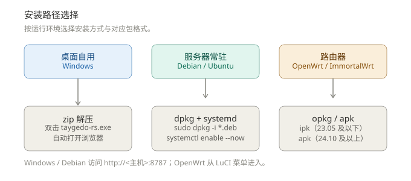
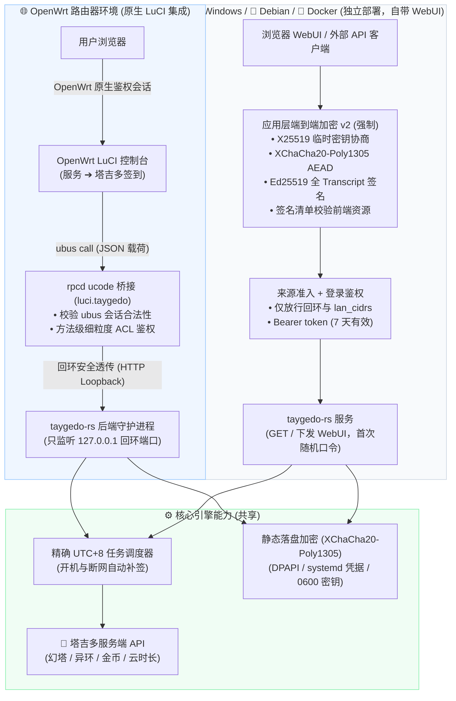
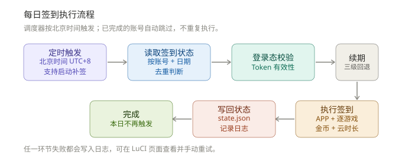
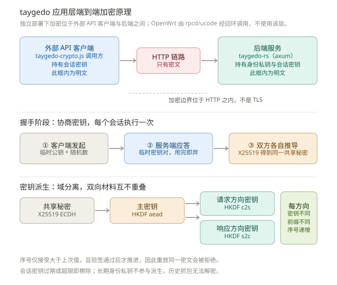
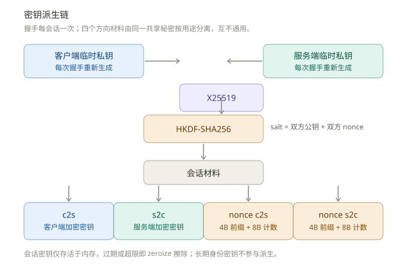

<div align="center">

# 🌸 塔吉多每日自动签到 (Rust 重写版)

<p align="center">
  <strong>高性能、单文件绿色运行的塔吉多（幻塔 / 异环等）全自动化签到与资产托管系统</strong>
</p>

<p align="center">
  <a href="https://github.com/LianXia233/taygedo-CI/releases/latest"></a>
  <a href="Cargo.toml"></a>
  <a href="#-分平台安装与运行"></a>
  <a href="#-双层安全加密传输与存储"></a>
  <a href="https://github.com/LianXia233/taygedo-CI/actions/workflows/build.yml"></a>
  <a href="LICENSE"></a>
  <a href="https://github.com/LianXia233/taygedo-CI/stargazers"></a>
</p>

<p align="center">
  <em>深度适配 OpenWrt LuCI 原生界面 · 独立部署自带 WebUI · X25519+XChaCha20 链路端到端加密 · 静态落盘密文保护 · 零运行时依赖</em>
</p>

<p align="center">
  <a href="#quick-start">🚀 快速上手</a> •
  <a href="#architecture">🌐 双轨架构</a> •
  <a href="#features">🌟 核心特性</a> •
  <a href="#install">📦 安装教程</a> •
  <a href="#security">🔒 双层加密</a> •
  <a href="#env">⚙️ 环境变量</a> •
  <a href="#faq">❓ 常见问题</a> •
  <a href="#license">📜 开源协议</a>
</p>

---

</div>

<a id="architecture-notice"></a>

> [!IMPORTANT]
> ### 📢 v0.7.1 之后（Unreleased）的分平台口径说明（必读）
>
> 同一份二进制，两种形态，**区别只在于"有没有内置 WebUI"**：
>
> 1. **🌐 OpenWrt 环境**：**LuCI 界面是唯一的图形交互入口**（「服务 ➔ 塔吉多签到」）。不提供内置 WebUI（`GET /` 返回 404），也没有自有口令登录。浏览器不直连服务端口、不持有加密材料；数据由服务端的 rpcd ucode 内部通道（`luci.taygedo`）以已认证 LuCI 会话身份回环请求 `http://127.0.0.1:<port>`。后端只监听回环，端口不对局域网开放。
> 2. **🪟 Windows / 🐧 Debian / 🐳 Docker 独立部署**：**自带内置 WebUI**（`http://127.0.0.1:8787`），账号密码登录，业务接口需 Bearer token。首次启动生成随机口令，仅在启动横幅 / 日志中打印一次。浏览器与后端之间走应用层加密 v2（X25519 + Ed25519 + XChaCha20-Poly1305），并配合 Ed25519 签名的静态资源清单做前端完整性校验——**没有静默明文降级**。
>
> 两条形态共用同一套业务 API 与加密实现，OpenWrt 侧的行为与 v0.7.1 完全一致。

---

<a id="quick-start"></a>
## 🚀 三步极速上手

<div align="center">
  
  <p><sub>图 1：按运行环境选择安装方式与管理形态</sub></p>
</div>

| 步骤 | 🌐 OpenWrt (软路由 / 硬件路由) | 🪟 Windows | 🐧 Debian / Ubuntu |
| :---: | :--- | :--- | :--- |
| **① 获取制品** | 下载对应架构的 `.ipk` 或 `.apk` | 下载解压 `taygedo-rs-windows-x86_64.zip` | 下载对应架构的 `taygedo-rs_*.deb` |
| **② 部署运行** | `opkg install` 或 `apk add`<br>*(自动注册守护进程并开机拉起)* | **双击 `taygedo-rs.exe`**<br>*(静默启动 HTTP API 服务，默认 8787)* | `sudo dpkg -i taygedo-rs_*.deb`<br>`sudo systemctl enable --now taygedo-rs` |
| **③ 交互管理** | 进入 LuCI 菜单：**服务 ➔ 塔吉多签到**<br>*(唯一管理入口；鉴权完全由 OpenWrt 负责)* | 通过 REST API 管理或由后台定时任务自驱<br>*(无内置网页，`GET /` 报 404)* | 通过 REST API 管理或由 systemd 守护自驱<br>*(无内置网页，`GET /` 报 404)* |

---

<a id="architecture"></a>
## 🌐 双轨管理架构对比



---

<a id="features"></a>
## 🌟 核心特性

<div align="center">
  
  <p><sub>图 2：全链路自动化签到与任务时序流</sub></p>
</div>

### 1. 账号体系与双模态登录
- **多账号相互隔离**：支持配置管理任意数量的游戏账号，独立存储凭据、各自分配定时任务，互不干扰。
- **密码登录（向下兼容）**：账号密码在本地经过 `scrypt + AES-256-GCM` 加密落盘，兼容上游数据格式。
- **短信验证码直登**：OpenWrt LuCI 界面与 API 支持一键下发短信验证码并自动完成授权绑定。
- **全自动多级凭据续期**：`accessToken` 失效 $\rightarrow$ 自动调用 `refreshToken` $\rightarrow$ 失败时利用 `laohuToken` 重建会话 $\rightarrow$ 仍失败则通过加密落盘凭据执行静默重登，长期免维护。

### 2. 自动化任务与防翻车机制
- **精确 UTC+8 时钟调度**：内置调度器强制锁死**北京时间（UTC+8）**计算，消除跨平台/跨时区宿主机偏差。
- **开机与断网自动补签**：若设定打卡时刻设备处于离线或断电状态，系统拉起或网络恢复后**自动触发补签**；单账号单日严格触发一次，避免重复。
- **全任务自动化覆盖**：
  - 塔吉多 APP 每日签到与福利领取；
  - 逐游戏签到打卡（**幻塔 1256**、**异环 1289** 等，自动展示对应游戏中文名）；
  - 金币任务全自动闭环（每日打卡、帖子浏览、动态点赞、一键分享）；
  - 云异环每日免费云游戏时长托管领取。
- **幽灵角色阻断机制**：优先采用 `getGameRecordCards` 战绩卡信息关联角色，彻底绕过 `getGameRoles` 偶发返回幽灵角色触发整账号 `code=5050` 崩溃的问题。

### 3. 双层企业级安全防护
- **传输层（端到端应用层加密）**：独立部署对外提供基于 **X25519 + Ed25519 + XChaCha20-Poly1305** 的密文信封传输，在非 HTTPS 环境下依然防范抓包嗅探。
- **存储层（静态落盘加密）**：核心数据文件采用 **XChaCha20-Poly1305** 全密文存储，主密钥依托系统原生底座（DPAPI / systemd-creds / 0600 文件）隔离。

---

<a id="install"></a>
## 📦 分平台安装与运行

### 平台包格式速查

| 平台环境 | 预编译包文件名格式 | 适用场景说明 |
| :--- | :--- | :--- |
| **OpenWrt (x86_64 软路由)** | `luci-app-taygedo_<版本>-1_x86_64.ipk`<br>`luci-app-taygedo_<版本>-r1_x86_64.apk` | 常见 PC 软路由、虚拟机（PVE/ESXi） |
| **OpenWrt (ARM64 路由)** | `luci-app-taygedo_<版本>-1_aarch64_cortex-a53.ipk`<br>`luci-app-taygedo_<版本>-r1_aarch64_cortex-a53.apk` | MT7986、RK3568、RK3588、高通等现代硬件路由器 |
| **Windows (x86_64)** | `taygedo-rs-windows-x86_64.zip` | 绿色解压即用单文件可执行程序 |
| **Debian / Ubuntu (amd64)** | `taygedo-rs_<版本>_amd64.deb` | 集成 systemd 服务管理与开机自启 |
| **Linux 通用 (musl)** | `taygedo-rs-<arch>-unknown-linux-musl.tar.gz` | 纯静态链接单文件，适用于 Alpine、Docker 或其他 Linux |

---

### 一、OpenWrt 路由器（首选推荐）

#### 1. 安装软件包
```sh
# apk 系统（OpenWrt 24.10 / 25.12+ / ImmortalWrt SNAPSHOT）
apk add --allow-untrusted /tmp/luci-app-taygedo_0.7.1-r1_x86_64.apk

# opkg 系统（OpenWrt 23.05 及更早分支）
opkg install /tmp/luci-app-taygedo_0.7.1-1_x86_64.ipk
```

#### 2. 开箱即用
安装完成后，脚本自动注册并拉起后台守护服务：
- 登录路由器 Web 管理页，进入「**服务 ➔ 塔吉多签到**」即可直接配置并使用；
- 后端固定仅监听 `127.0.0.1`，鉴权直接由当前 LuCI 会话接管，安全无忧。

#### 3. 常用运维指令
```sh
# 查看运行日志
logread | grep taygedo

# 服务启停控制
/etc/init.d/taygedo restart
/etc/init.d/taygedo status
```

---

### 二、Windows 平台

1. **下载解压**：在 [Releases](https://github.com/LianXia233/taygedo-CI/releases/latest) 下载 `taygedo-rs-windows-x86_64.zip` 并解压，得到单文件 `taygedo-rs.exe`。
2. **启动运行**：
   - 双击 `taygedo-rs.exe` 直接在后台运行服务（默认监听 `127.0.0.1:8787`）；
   - 或在 PowerShell 中带环境变量启动：
     ```powershell
     $env:TAYGEDO_LISTEN = "127.0.0.1:8787"
     $env:TAYGEDO_DATA_DIR = "D:\taygedo-data"
     .\taygedo-rs.exe
     ```
3. **打开界面**：启动后会自动用默认浏览器打开 `http://127.0.0.1:8787`；后台窗口首次启动会打印一次随机口令（账号固定 `admin`），登录后请在「设置 ➔ 修改账号密码」立即改掉。
4. **验证连通性**：
   ```powershell
   curl http://127.0.0.1:8787/api/meta
   ```
   输出包含 `"edition":"standalone"`、`"webui_enabled":true` 与 `"auth_mode":"token"` 即表示服务正常运行。

---

### 三、Debian / Ubuntu 平台

1. **安装 deb 软件包**：
   ```bash
   sudo dpkg -i taygedo-rs_0.7.1_amd64.deb
   sudo apt-get install -f # 补齐依赖（静态单文件通常零依赖）
   ```
2. **启用 systemd 服务**：
   ```bash
   sudo systemctl enable --now taygedo-rs
   sudo systemctl status taygedo-rs
   ```
3. **查看实时日志**：
   ```bash
   sudo journalctl -u taygedo-rs -f
   ```
4. **打开界面**：浏览器访问 `http://<服务器IP>:8787`。首次启动的随机口令在启动日志里只出现一次：
   ```bash
   sudo journalctl -u taygedo-rs | grep -A3 "首次启动"
   ```
   也可以在安装前用 `TAYGEDO_WEB_PASSWORD` 指定初始口令（见下方环境变量表）。

---

### 四、Docker 容器化部署

项目根目录已附带 `Dockerfile` 与 `docker-compose.yml`：

```bash
# 启动容器
docker compose up -d --build
```

服务将在 `http://localhost:8787` 暴露 REST API 与内置 WebUI，所有账号与密钥数据自动挂载持久化于本地 `./data` 目录。

> [!NOTE]
> 容器内监听 `0.0.0.0`，浏览器访问 `http://<宿主机IP>:8787` 时来源必须命中 `lan_cidrs`（默认已含 RFC1918 私网段），否则会返回 403。首次启动口令请用 `docker compose logs` 查看，或在 `environment` 中显式设置 `TAYGEDO_WEB_PASSWORD`。

---

<a id="security"></a>
## 🔒 双层安全加密传输与存储

项目建立了从“外部调用传输”到“本地数据落地”的双层独立安全防线：

<div align="center">
  
  <p><sub>图 3：应用层端到端加密与密钥派生全链路</sub></p>
</div>

### 1. 传输层加密（面向独立部署的 API 客户端）

| 环节 | 采用算法 / 机制 | 安全设计亮点 |
| :--- | :--- | :--- |
| **服务端身份锚点** | **Ed25519** 长期身份签名 | 密钥安全封存于 `keyring.json`，对外呈现固定 Key ID |
| **密钥协商** | **X25519** 临时 ECDH | 每次握手动态生成随机公私钥对，实现前向保密（PFS） |
| **密钥派生** | **HKDF-SHA256** | 绑定完整握手 Transcript，双向分离派生 `c2s` / `s2c` 对称密钥 |
| **正文密文传输** | **XChaCha20-Poly1305** | 24 字节大 Nonce，彻底杜绝 Nonce 碰撞与反射攻击 |
| **防篡改与防重放** | **AAD 强绑定 + 4096 滑窗** | AAD 绑定请求方法、路径、序列号与会话 ID；滑动窗口严格防重放 |

> [!NOTE]
> 独立部署的内置 WebUI 与外部 API 客户端**都走**上述信封层：页面加载 `taygedo-crypto.js` 后先验签资源清单、再握手验签，登录口令与业务数据一律加密传输，`crypto_policy` 要求加密时明文请求直接 `428`（不存在"失败后降级明文"的旁路）。
> OpenWrt 内部通信走回环内部通道（127.0.0.1），由 LuCI 会话校验接管，不强制使用信封层。

---

### 2. 本地存储加密（静态落盘加密）

<div align="center">
  
  <p><sub>图 4：本地多域隔离密钥派生链</sub></p>
</div>

- **全密文落地**：`accounts.json`、`config.json`、`state.json`、`keyring.json` 文件头部包含 `TGDENV01` 标识，正文由 XChaCha20-Poly1305 密文存储，并绑定文件逻辑身份。即便整机磁盘或备份镜像被盗，无法解密明文。
- **平台主密钥原生防护**：
  - **Windows**：调用 Windows DPAPI（`CryptProtectData`），密钥与系统登录用户或机器绑定；
  - **Linux**：优先尝试 systemd 加密凭据（TPM2），回落至 `root:root 0600` 专用文件保护；
  - **OpenWrt**：由 `0600` 严格权限密钥文件保护。

---

<a id="env"></a>
## ⚙️ 环境变量配置参考

独立运行 `taygedo-rs` 时，支持通过环境变量灵活控制运行时行为：

| 环境变量 | 默认值 | 功能说明 |
| :--- | :--- | :--- |
| `TAYGEDO_LISTEN` | `0.0.0.0:8787` (独立) / `127.0.0.1:8787` (OpenWrt) | HTTP 服务监听地址与绑定端口 |
| `TAYGEDO_DATA_DIR` | `data` (独立) / `/etc/taygedo` (OpenWrt) | 数据持久化存放目录路径 |
| `TAYGEDO_LAN_CIDRS` | RFC1918 网段全集 | 受信来源 IP 网段白名单（CIDR），未命中来源一律拦截 403 |
| `TAYGEDO_CRYPTO_POLICY` | `auto` | 传输加密准入策略：`auto`（局域网明文/外网强制加密）、`always`、`never` |
| `TAYGEDO_WEB_PASSWORD` | 随机生成 | （仅独立部署）首次启动的 WebUI 初始口令，账号固定 `admin`；不设置则随机生成并只在启动横幅打印一次 |
| `TAYGEDO_NO_AUTH` | 关闭 | （仅 OpenWrt 排障路径）免鉴权放行；独立部署设置该变量会被**强制忽略** |
| `TAYGEDO_DEFAULT_SCHEDULE`| 无 | 覆盖全局默认签到执行时间（格式：`HH:MM`） |
| `TAYGEDO_COIN_TASKS` | 无 | 覆盖金币打卡任务全局开关（`true` / `false`） |
| `TAYGEDO_CLOUD_DURATION` | 无 | 覆盖云异环免费时长全局开关（`true` / `false`） |
| `TAYGEDO_LUCI_SESSION_CHECK` | `true` | （仅 OpenWrt 生效）是否强校验 LuCI 会话，设为 `false` 退回仅回环放行 |

---

<a id="faq"></a>
## ❓ 常见问题 (FAQ)

<details>
<summary><strong>Q: 在浏览器打开 <code>http://127.0.0.1:8787</code> 返回 404 Not Found？</strong></summary>

> 这是 **OpenWrt 形态**的正常现象：该形态不提供内置 WebUI，入口是 LuCI 菜单「**服务 ➔ 塔吉多签到**」。
> 在 **Windows / Debian / Docker** 独立部署下，同一地址应直接打开登录界面；若也返回 404，检查是否误设了 `TAYGEDO_EDITION=openwrt`（`/api/meta` 的 `edition` 字段可直接确认）。
</details>

<details>
<summary><strong>Q: 忘了 WebUI 登录口令怎么办？</strong></summary>

> 用环境变量覆盖，**不需要**删数据目录：
> ```bash
> TAYGEDO_WEB_PASSWORD='新的口令' taygedo-rs   # 或写进 systemd / docker-compose 的环境变量
> ```
> `TAYGEDO_WEB_PASSWORD` 是显式优先项：设置即以它为准并覆盖存储口令，不设置才沿用 UI 里改过的口令。改完记得移除该变量，或在 UI 里重新设置一个。
</details>

<details>
<summary><strong>Q: 如果签到设定的时间电脑关机或路由器断网了怎么办？</strong></summary>

> **无需担心**。
> 系统内置智能补签机制：只要当天未完成打卡，在设备开机拉起或网络重新恢复连接后，程序会在首次心跳检测到网络通畅时**自动执行当天补签**，单日严格幂等触发一次。
</details>

<details>
<summary><strong>Q: 启动报错 <code>[fatal] 主密钥缺失</code> 怎么救？</strong></summary>

> 本地数据文件全部经过强加密存储，必须持有对应的主密钥（`keys/master.key` 或 DPAPI 文件）方可解密。
> - 若有备份：请将备份的密钥文件放回 `data/keys/` 目录并恢复 `0600` 权限；
> - 若未备份且密钥已丢失：由于算法杜绝任何后门，无法恢复历史数据，请清空数据目录重新录入账号。
</details>

<details>
<summary><strong>Q: 手机移动端可以访问管理吗？</strong></summary>

> **完全支持**。
> 在 OpenWrt 部署环境下，原生 LuCI 视图对移动端做了全尺寸响应式适配，使用手机浏览器登录路由器后台即可随时随地管理；
> 独立部署的内置 WebUI 同样是移动优先的响应式布局（含 `viewport-fit=cover` 刘海屏适配），手机浏览器直连 `http://<IP>:8787` 即可操作。
</details>

---

<a id="license"></a>
## 📜 开源协议与鸣谢

| 模块范围 | 适用开源许可证 | 说明 |
| :--- | :--- | :--- |
| **本项目 Rust 完整实现与 LuCI 扩展** | **GPL-3.0-only** | 详细条款参见根目录 [`LICENSE`](./LICENSE) |
| **上游业务算法与逻辑参考源** | **MIT License** | 参考源：[zzstar101/taygedo-auto-attendance](https://github.com/zzstar101/taygedo-auto-attendance) |

- 本项目由 [zzstar101/taygedo-auto-attendance](https://github.com/zzstar101/taygedo-auto-attendance)（TypeScript 版，MIT 协议）完整基于 Rust 进行重构与安全加固。
- 保留上游版权声明，衍生与工程实现整体遵循 **GPL-3.0** 开源发布。

<div align="center">

**如果这个项目为你省去了每日繁琐的打卡操作，欢迎点一个 ⭐️ Star 给予支持！**

</div>
